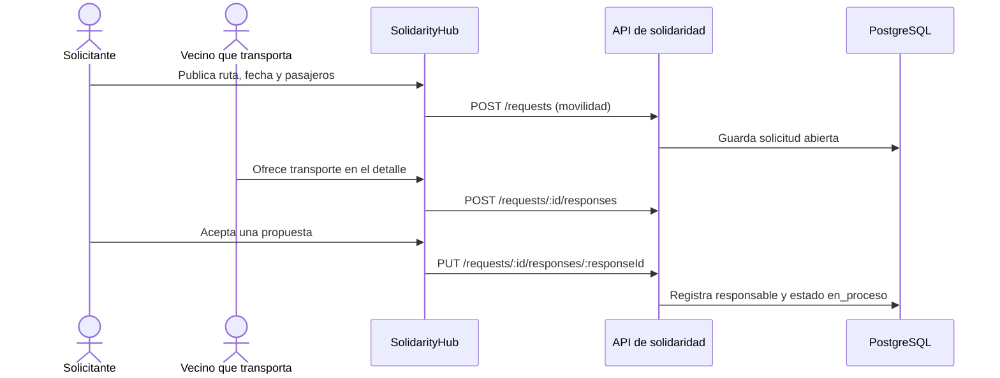
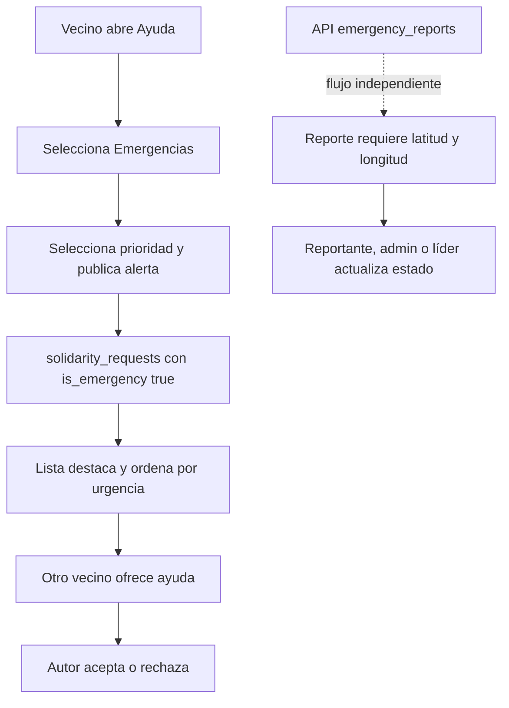

# 01. Descripción funcional

## 1. Muro de necesidades y ofrecimientos

**Objetivo.** Publicar y consultar necesidades y ofrecimientos vecinales con categoría, ubicación por zona, descripción y estado.

**Funcionamiento.** La pestaña **Muro solidario** presenta publicaciones obtenidas desde `GET /api/solidarity/requests`. Admite búsqueda textual (`q`) y filtro por tipo (`type`). Una persona autenticada crea una publicación con el formulario **Publicar en el muro**, que envía título, descripción, categoría, zona, tipo e intención (`necesidad` u `ofrecimiento`). La zona omitida se completa con el barrio del perfil en el backend. El detalle muestra las respuestas y habilita ofrecimientos a otras personas.

Los tipos admitidos por la API son `prestamo`, `donacion`, `intercambio_habilidad`, `movilidad` y `ayuda_temporal`. El estado general es `abierta`, `en_proceso`, `resuelta` o `cancelada`. El autor puede editar título, descripción, categoría y zona en la interfaz, cambiar el estado general (excepto resolver anticipadamente préstamos) y eliminar publicaciones permitidas por las reglas del backend.

**Persistencia.** `solidarity_requests` guarda la publicación; `solidarity_responses` guarda las propuestas de otros usuarios. La relación es uno a muchos desde solicitud a respuesta.

## 2. Préstamos, donaciones e intercambio de habilidades

Estas modalidades se implementan sobre las mismas dos tablas y el mismo formulario del muro. No existe una tabla de inventario separada.

### Donaciones

Se crea una publicación con tipo **Donación** y se escoge **Necesito ayuda** para solicitarla o **Ofrezco ayuda / recurso** para ofrecerla. Otra persona puede enviar una propuesta desde el detalle. El autor puede aceptarla o rechazarla. No hay un flujo específico de entrega, inventario o cierre de donación distinto del estado general de solidaridad.

### Préstamos

El usuario publica tipo **Préstamo**, indica si necesita el artículo o lo ofrece y describe el artículo. La otra persona registra una respuesta con un mensaje que sirve como propuesta para prestar. El solicitante acepta o rechaza desde el detalle.

En la base, `solidarity_requests.user_id` identifica a quien solicita/recibe; `resolved_by_user_id` se asigna al usuario cuya propuesta se acepta, es decir, quien presta. El estado del préstamo recorre `solicitado` → `ofrecido` → `aceptado` → `entregado` → `devuelto`. El prestamista confirma **Confirmar entrega del artículo**; el receptor confirma **Registrar devolución y resolver**. La última acción escribe la fecha de devolución y cambia el estado general a `resuelta`.

El backend impide resolver un préstamo antes de la devolución, impediría que un tercero confirme entrega/devolución y bloquea eliminar solicitudes cuyo préstamo ya fue aceptado, entregado o devuelto.

### Intercambio de habilidades

Se publica con tipo **Habilidad / servicio** y una intención de necesidad u ofrecimiento. Las respuestas son mensajes libres y el autor puede aceptar o rechazar propuestas. No hay campos estructurados de habilidad, calendario de servicio ni ciclo de finalización específico.

```mermaid
sequenceDiagram
  actor A as Solicitante / receptor
  actor B as Prestamista
  participant UI as SolidarityHub
  participant API as API de solidaridad
  participant DB as PostgreSQL
  A->>UI: Publica solicitud tipo prestamo
  UI->>API: POST /requests
  API->>DB: Guarda loan_status solicitado
  B->>UI: Envía oferta desde el detalle
  UI->>API: POST /requests/:id/responses
  API->>DB: Guarda respuesta y estado ofrecido
  A->>UI: Acepta la propuesta
  UI->>API: PUT /requests/:id/responses/:responseId
  API->>DB: Asigna prestamista; estado aceptado
  B->>UI: Confirma entrega
  UI->>API: PUT /requests/:id/loan {event: entregado}
  A->>UI: Registra devolución
  UI->>API: PUT /requests/:id/loan {event: devuelto}
  API->>DB: Registra devolución y marca resuelta
```
## 3. Solicitudes de movilidad solidaria

Una solicitud se publica con tipo **Movilidad solidaria**. La interfaz pide punto de partida, destino, fecha y hora y número de pasajeros, además del título, descripción/motivo, categoría y zona. El backend valida que origen, destino, fecha y cantidad positiva estén presentes; guarda los valores en `departure`, `destination`, `travel_at`, `passengers` y `reason`.

Otros usuarios ofrecen transporte respondiendo a la solicitud. El autor puede aceptar o rechazar. La aceptación cambia el estado general a `en_proceso` y registra como responsable al usuario de la respuesta aceptada (`resolved_by_user_id`). El esquema no contiene campos especializados de vehículo ni un estado de traslado diferente del estado general. La interfaz no proporciona una acción específica para confirmar fin del viaje.


## 4. Respuestas y estados de atención

Una respuesta contiene mensaje, usuario que responde, solicitud, posible solución opcional, teléfono de contacto opcional, estado y fecha. El detalle obtiene la colección de respuestas y el nombre de cada autor. La persona que publicó puede aceptar/rechazar; al aceptar, el responsable queda registrado y la solicitud pasa a `en_proceso`. En préstamos el flujo se extiende con el endpoint de entrega/devolución.

El esquema conserva fechas de creación, pero no una bitácora histórica de cada transición. Los cambios sobrescriben el estado actual. Para solicitudes no relacionadas con préstamos, el endpoint también conserva la operación `completado` para respuestas.

## 5. Modo emergencia y prioridades

En `SolidarityHub`, el tab **Emergencias** lista solicitudes de solidaridad con `is_emergency=true`, ordenadas primero por prioridad y luego por fecha. La creación en ese tab envía `is_emergency=true` y la prioridad seleccionada: `critica`, `alta`, `media` o `baja`. Los nombres visibles son Crítica, Alta, Media y Baja.

La tarjeta destaca visualmente la emergencia. La prioridad se almacena en `solidarity_requests.urgency`; una solicitud puede recibir ofrecimientos y su autor gestionar las respuestas. En una publicación ya creada, cambiar `urgency` o `is_emergency` por `PUT /api/solidarity/requests/:id` requiere rol `admin`.

Existe además el tablero geolocalizado `emergency_reports`, con endpoints independientes y campos de latitud/longitud obligatorios al crear. No se conecta desde el frontend de `SolidarityHub`; véase [API REST](04-api-rest.md).


## 6. Directorio de grupos y recursos

La pestaña **Directorio** lista recursos activos desde `GET /api/emergency/resources` y permite filtrar por texto en nombre, descripción o dirección. Una persona autenticada puede registrar nombre, categoría, teléfonos, dirección, zona, horario y descripción mediante **Registrar un recurso comunitario**. El botón **Llamar** abre el teléfono de emergencia, si existe, o el de contacto.

Las categorías válidas por enum son `salud`, `bomberos`, `seguridad_vecinal`, `comedor_popular`, `refugio` y `voluntariado`. La API guarda el usuario creador. No hay rutas de actualización o baja en el archivo de rutas; el frontend no ofrece administración posterior del registro.
