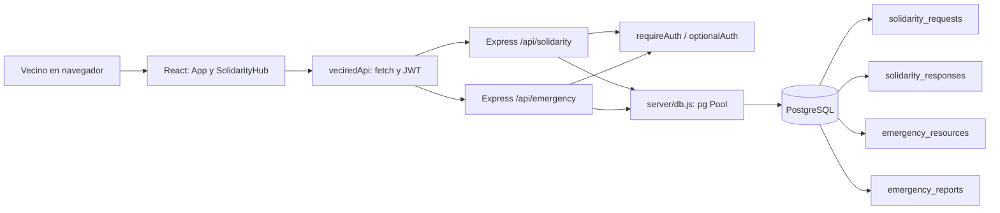

# 02. Arquitectura y tecnologías

## Arquitectura

El módulo conserva la arquitectura monolítica por capas del repositorio: una SPA React mantiene navegación por estado local, un servicio API compartido realiza solicitudes HTTP y un servidor Express monta rutas modulares. Los handlers de ruta aplican validaciones y reglas de autorización y ejecutan consultas SQL parametrizadas mediante `server/db.js` (`pg`) contra PostgreSQL. No hay una capa de controladores, modelos ORM o repositorios independiente.

## Tecnologías comprobables

| Área | Tecnología observada |
|---|---|
| Lenguajes | JavaScript (ES modules), JSX, SQL |
| Frontend | React 19, Vite 8, CSS |
| Cliente HTTP | `fetch` en `app/src/api/veciredApi.js` |
| Backend | Node.js, Express 4 |
| Base de datos | PostgreSQL con `pg` |
| Autenticación | JWT (`jsonwebtoken`), contraseñas `bcryptjs` en el módulo de autenticación |
| Middleware adicional | CORS, `dotenv` |
| Empaquetado web | `vite-plugin-pwa` está configurado en el frontend |

Las dependencias se declaran en `app/package.json` y `server/package.json`. La documentación no presupone que la PWA ni capacidades offline formen parte del flujo solidario.

## Integración con el resto de VeciRed

- Reutiliza `users` y la autenticación existente de `/api/auth`.
- Comparte la navegación principal: el botón inferior **Ayuda** conduce a la pantalla de solidaridad. Desde el hub se cambian las pestañas de muro, emergencias y directorio.
- No sustituye los módulos de catálogo, mapa, cuenta ni publicaciones comerciales.
- El mapa existente no está conectado a las publicaciones de movilidad ni al tablero de emergencias en este componente.

## Archivos del módulo

### Creados para el módulo

| Archivo | Responsabilidad |
|---|---|
| `app/src/features/solidarity/SolidarityHub.jsx` | Vista integrada y flujos del módulo. |
| `app/src/features/solidarity/solidarity.css` | Presentación responsive. |
| `database/006_solidarity_mobility.sql` | Intención de publicaciones y campos de movilidad. |
| `database/007_loan_lifecycle.sql` | Estado y marcas de tiempo del ciclo de préstamo. |

### Archivos existentes extendidos

| Archivo | Cambio/responsabilidad en la integración |
|---|---|
| `app/src/App.jsx` | Monta las pantallas solidaridad/emergencia en la navegación existente. |
| `app/src/api/veciredApi.js` | Expone wrappers HTTP para solidaridad y emergencias. |
| `server/routes/solidarity.routes.js` | Consultas, publicación, gestión de respuestas y transiciones de préstamo. |
| `server/routes/emergency.routes.js` | Consulta/búsqueda de recursos y autorización del estado de reportes. |
| `server/migrate.js` | Incluye las migraciones 006 y 007 en su lista de ejecución. |

### Archivos existentes reutilizados sin cambios específicos del módulo

`server/index.js` monta las rutas; `server/db.js` gestiona `pg`; `server/middleware/auth.js` implementa JWT; `app/src/components/BottomNav.jsx` aporta el acceso Ayuda; `database/001_schema.sql` define las tablas base y `database/002_permissions_functions.sql` define triggers/políticas generales.
