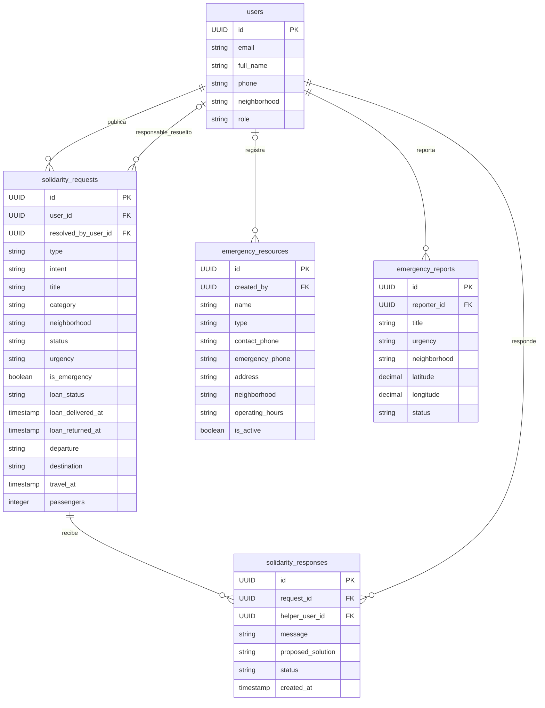

# 03. Modelo de datos

Las tablas base se declaran en `database/001_schema.sql`; las columnas para intención y movilidad en `006_solidarity_mobility.sql`; el ciclo de préstamo en `007_loan_lifecycle.sql`.

## Entidades y relaciones

### `users`

Entidad de cuenta reutilizada. En este módulo se consultan `id`, `full_name`, `phone`, `neighborhood` y `role`. El rol es enum `user_role` (`vecino`, `comerciante`, `profesional`, `lider_comunitario`, `admin`).

### `solidarity_requests`

- PK: `id UUID`.
- FK: `user_id → users.id` (autor/solicitante, borrado en cascada).
- FK: `resolved_by_user_id → users.id` (usuario responsable aceptado, `ON DELETE SET NULL`). Para el préstamo representa al prestamista; el usuario autor es quien recibe.
- Datos generales: `type`, `title`, `description`, `category`, `neighborhood`, `latitude`, `longitude`, `urgency`, `is_emergency`, `status`, fechas de creación/actualización.
- `type` usa enum `request_type`: préstamo, donación, intercambio de habilidades, movilidad o ayuda temporal.
- `intent`, agregado en migración 006: `necesidad` u `ofrecimiento`.
- Movilidad, migración 006: `departure`, `destination`, `travel_at`, `passengers`, `reason`.
- Préstamo, migración 007: `loan_status`, `loan_delivered_at`, `loan_returned_at`. Los estados permitidos por `CHECK` son `solicitado`, `ofrecido`, `aceptado`, `entregado`, `devuelto`; puede ser `NULL` para publicaciones no relacionadas con préstamos y ciertos registros históricos resueltos cuyo paso anterior no se puede inferir.

### `solidarity_responses`

- PK: `id UUID`.
- FK: `request_id → solidarity_requests.id` y `helper_user_id → users.id`, ambas con borrado en cascada.
- Guarda `message`, `proposed_solution`, `contact_phone`, `status`, `client_id` y `created_at`.
- En préstamos, `helper_user_id` es el candidato a prestamista; al aceptar, su id se copia en `solidarity_requests.resolved_by_user_id`.

### `emergency_resources`

PK `id UUID`; FK nullable `created_by → users.id` con `ON DELETE SET NULL`. Guarda clasificación, descripción, teléfonos, dirección/zona, coordenadas opcionales, horario, activo y verificación.

### `emergency_reports`

PK `id UUID`; FK `reporter_id → users.id` con borrado en cascada. Guarda descripción, prioridad, cantidad de afectados, necesidades críticas, barrio y coordenadas obligatorias, estado y responsable textual de atención. Esquema independiente de emergencias del muro `solidarity_requests`.

## Estados

El enum `request_status` limita el estado general a `abierta`, `en_proceso`, `resuelta` y `cancelada`. `urgency` usa `emergency_urgency`: `critica`, `alta`, `media`, `baja`. El estado de respuesta es `VARCHAR(30)`; el código utiliza `ofrecido`, `aceptado`, `rechazado`, `entregado` y `completado` según la operación.

El estado del reporte de emergencia es `VARCHAR(30)` y la ruta valida `pendiente`, `en_atencion`, `atendido`.
